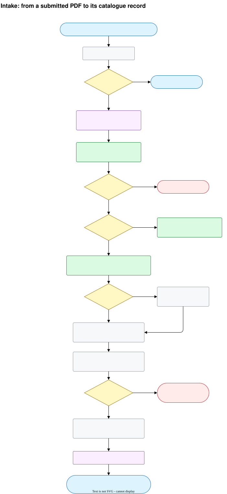
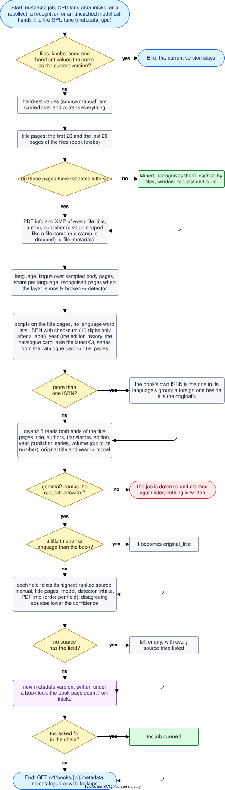
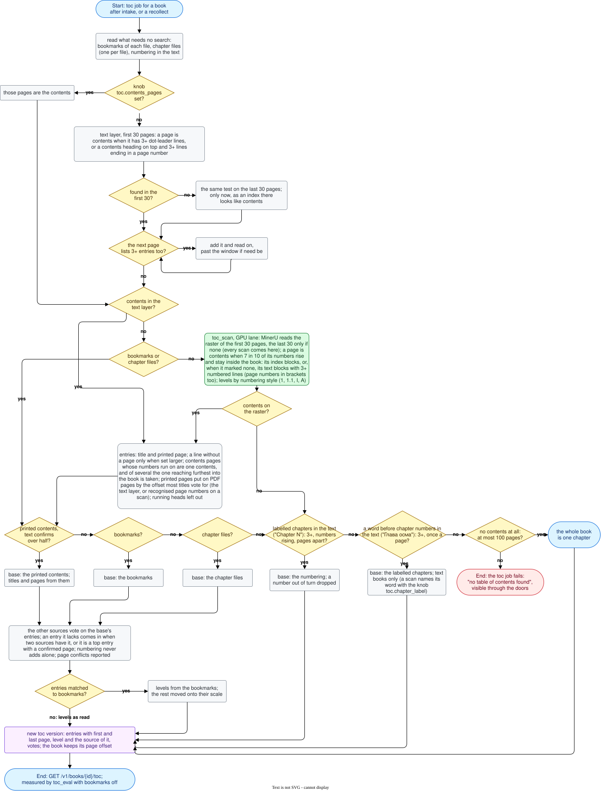
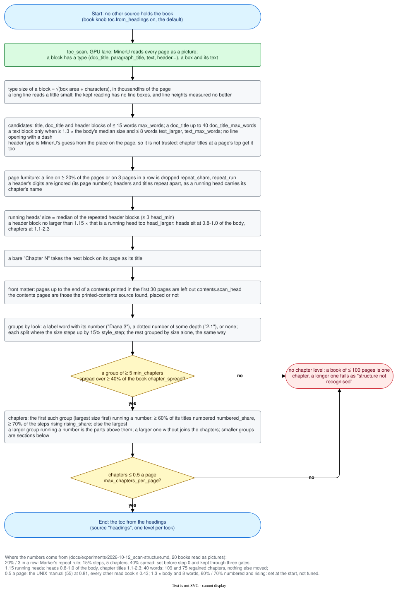
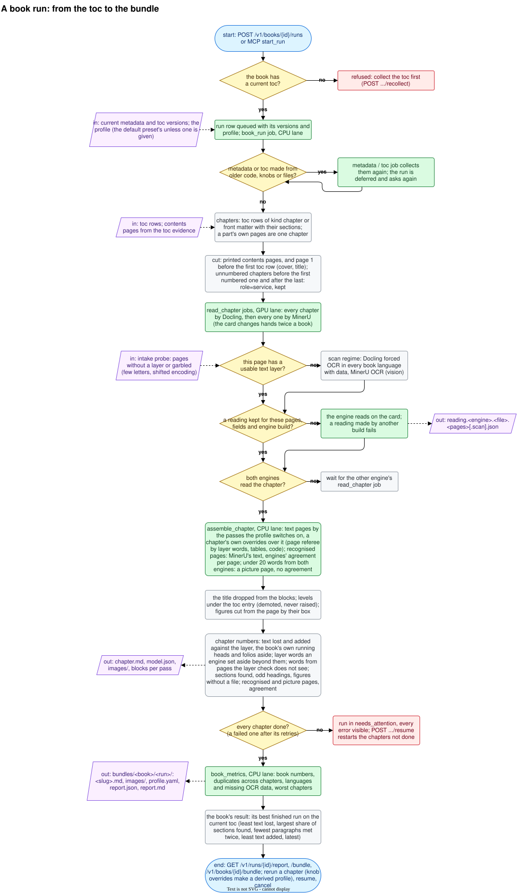
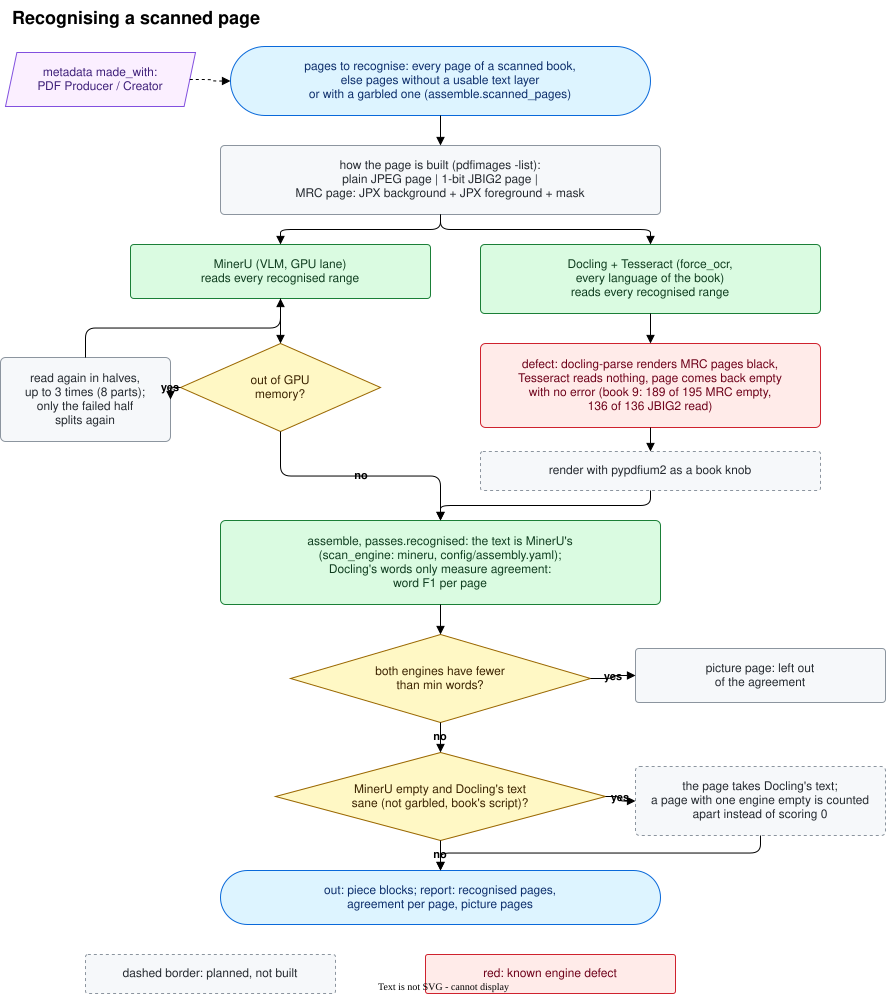
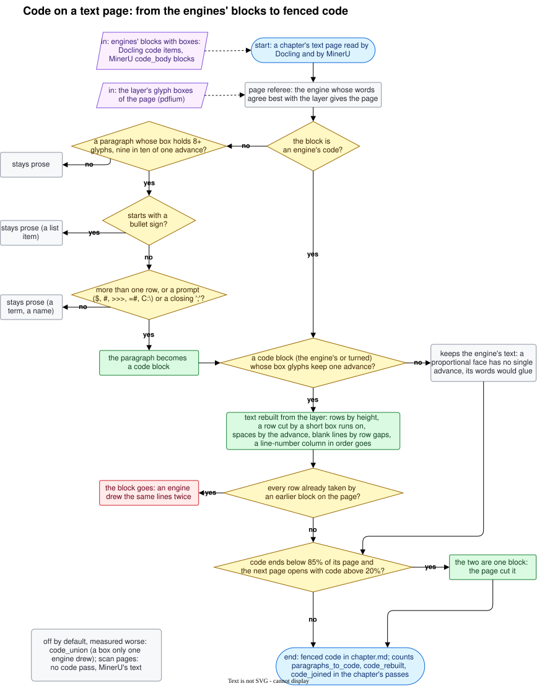

# ocr-lab

[](https://github.com/rikitikitav1/ocr-lab/actions/workflows/ci.yml)
[](LICENSE)
[](pyproject.toml)
[](https://github.com/astral-sh/ruff)

ocr-lab turns an e-book into a structured document whose sections match the book. You feed it a PDF
(text or scanned, one file or several), pick an output format, and get back Markdown with the book's
chapters at the right heading levels, a folder of images linked from the text, and a report that
says how good the result is. The first output format is Markdown; DoclingDocument for RAG comes later,
as do EPUB and HTML inputs.

Why: the bundles are the sources of a retrieval system ([rag-lab](https://github.com/rikitikitav1/rag-lab)), and
such a system answers no better than its sources. Text lost on the way cannot be found by any question. A chapter
cut in the wrong place gives pieces that mix two topics, and a heading at the right level is the context a piece of
text needs to be found. A table or a code listing read as prose loses what it says, and running heads and pages
taken twice add noise that ranks next to the real text. So the stand keeps the book's own structure, reads every
page by two engines and the text layer, and reports per chapter what was lost and what was added instead of
claiming the result is good.

Every book is different, so there is no single setting for all of them. Each book gets its own profile
of knobs (where the table of contents comes from, how a chapter title, a code block, a sidebar, a table
or a running head is recognised), the stand picks the values by measuring them, and every stage leaves
a file behind, so a run can be traced step by step and resumed after a crash.

What was measured and decided, change by change, is in [docs/experiments.md](docs/experiments.md); what each
number of the report means is in [docs/measurement.md](docs/measurement.md). По-русски: [docs/README_ru.md](docs/README_ru.md).

The rules the project keeps are in the [constitution](.specify/memory/constitution.md); the feature
being built is specified in [specs/001-pdf-book-to-markdown](specs/001-pdf-book-to-markdown/spec.md).

## Status

Where each step stands: [docs/status.md](docs/status.md).

## What happens to a PDF today

<details open>
<summary>Diagram: from a submitted PDF to a catalogue record with metadata</summary>



</details>

<details>
<summary>Diagram: collecting a book's metadata, every branch and what each source gives</summary>



</details>

<details>
<summary>Diagram: finding the table of contents, every branch</summary>



</details>

<details>
<summary>Diagram: chapters from the headings, the last try, with each threshold and where it comes from</summary>



</details>

1. **Submit.** `POST /v1/books` (or the MCP tool `add_book`) takes paths on the shelf or under
   `data/inbox`, in order; `POST /v1/books/upload` takes the bytes. A book is identified by the hashes
   of its files in order, so the same files submitted again return the same book and nothing is queued.
   Two editions are two books. A book split into several files is one submission; volumes of a series
   are separate books linked by the `series` and `volume` fields. A file is stored once by its content
   (`data/files/`); the book's folder links each of its files by order and name in `data/books/<id>/source/`.
2. **Intake** (CPU lane). Per page: is there a text layer. Per file: bookmarks. In the first pages:
   printed contents lines with dot leaders. The result is kept as `probe.json` and reused while the
   files are unchanged.
3. **Metadata** (CPU lane; a recognition or a model call not yet cached moves the job to the GPU lane).
   The title and copyright pages (the first 20 and the last 20 by default; a book knob, see below) are
   read from the text layer, or recognised by MinerU when there is none or it is garbled. Scripts come
   first and use no language word lists: the PDF's info and XMP of every file (a value shaped like a file
   name or a stamp is ignored; Producer and Creator are kept as `made_with`), ISBN by the ISBN agency's rules (of two printed, a translation keeps the one registered in its language's group, told by the agency's ranges and CLDR), year, the catalogue card's series, the language
   of the body text. Then a local model (ollama) reads the title pages for the title, authors, edition,
   volume and publisher and names the book's subject. Everything comes from the book itself: no
   catalogue or web lookups at this stage.
4. **Resolve.** Each field takes the value of its highest-ranked source. Sources that disagree are
   marked as a conflict and lower the confidence. A field nobody found stays empty and lists every
   source that was tried; nothing is guessed. The result is a new metadata version; older versions
   are kept.
5. **What you get.** `GET /v1/books/{id}` shows files, pages, text layer, bookmarks, printed contents
   and metadata; `GET /v1/books/{id}/metadata` shows every field with its value, source, confidence
   and attempts. A field can be set by hand (`PATCH /v1/books/{id}/metadata/{name}`, a new version);
   the book content itself is never edited by hand. `POST /v1/books/{id}/recollect` collects again; with `"run": true` it starts a run once the toc is collected, so `what` must hold `toc`.
6. **Table of contents** (CPU lane; GPU only to recognise a raster). The contents printed in the book
   are found in the text layer, or on the raster when neither the text, the bookmarks nor chapter
   files give one; contents spread over several pages are read as one, and their printed pages are put
   on PDF pages. Reconciled with the bookmarks, chapter files and numbering, the result is a toc
   version with every entry's first and last page (`GET /v1/books/{id}/toc`). When nothing else holds
   the contents, the labelled chapters in the text ("Chapter N", three or more, numbers rising) are the
   toc. With none of these, every page is read as a picture and the headings grouped by look give the
   chapters (book knob `toc.from_headings`, on by default); when they give none, or more than one chapter
   to two pages, a book of at most 100 pages is one chapter and a longer one fails with "structure not
   recognised". `POST /v1/eval/toc` with `bookmarks_off` scores it against the bookmarks.
7. **Run** (`POST /v1/books/{id}/runs`, MCP `start_run`). Every chapter is read by Docling and by
   MinerU on the GPU lane, then assembled on the CPU lane page by page; pages without a usable layer
   are read by both engines in OCR mode. A run assembles with a profile: the value of every run knob
   with where it came from (the default preset's unless a profile is given). The bundle under
   `bundles/<book>/<run>/` holds the book's Markdown, images, `profile.yaml` and
   `report.json`/`report.md` with numbers per chapter and per book: text lost and added against the
   layer (the book's own running heads and page numbers aside), layer words an engine set aside beyond
   them, words from pages the layer check does not see, sections found, paragraphs met twice in a chapter, layer word runs out of order, recognised and
   picture pages and the engines' agreement. When two chapters meet on one page, it is cut at their titles
   and scored over both. A range MinerU cannot fit in GPU memory is read again in halves. A chapter can be rerun with knob overrides
   (`POST /v1/runs/{id}/chapters/{ord}/rerun`), which makes a derived profile. The book's result is its
   best finished run on the current toc.

<details>
<summary>Diagram: a book run, from the toc to the bundle</summary>



</details>

<details>
<summary>Diagram: recognising a scanned page, from the two engines to the agreement</summary>



Both engines read every recognised range; the text is MinerU's and Docling's words only measure agreement. Dashed boxes are planned, not built.

</details>

<details>
<summary>Diagram: code on a text page, from the engines' blocks to fenced code</summary>



</details>

Book-level knobs can be given at submission (`"knobs": {...}` in `POST /v1/books`) or changed later
(`PATCH /v1/books/{id}/knobs`): `metadata.title_pages.head` and `.tail` (20 and 20 by default, in
`config/metadata.yaml`), `toc.contents_pages`, the printed contents pages as `[[first, last], ...]`
when you know where they are, `toc.skip_root_bookmark` when the first bookmark is the book itself,
`toc.ignore_bookmarks` when the bookmarks are not the contents (one per page, image file names),
`toc.chapter_label`, a word chapters open with: a line of it and one more word at a page's top opens a
chapter ("درس" for the lessons "درس اول", "درس دوم" of a Farsi reader; a scan is then recognised whole), and
`toc.from_headings` (on by default), the last try before a book with no contents fails: every page is read as
a picture and the chapters come from its headings grouped by look (`config/toc.yaml`, `scan_layer.headings`);
false lets the book fail at once.
A change takes effect at the next collection. A submission may also say `"then": ["toc"]` to skip
metadata, and `"order": "by_number"` to order chapter files by the number each prints.

Run knobs are listed with their options, help and defaults at `GET /v1/knobs` (`config/knobs.yaml`,
defaults in `config/assembly.yaml`), presets at `GET /v1/presets` (`config/presets/`). A profile is read
at `GET /v1/profiles/{id}`; `POST /v1/profiles/{id}/derive` with `{"set": {...}, "chapters": {"<ord>":
{...}}}` makes a new one to run with (`"profile_id"` in `POST /v1/books/{id}/runs`).

A stage that keeps failing stops after its attempt budget (3 to 5, per stage, in
`config/budgets.yaml`) and waits; after a look, `POST /v1/jobs/retry` gives it a fresh budget. A retried job of a run reopens its chapter and the run, so its success finishes
the run as `resume_run` would; a run whose start or bundle failed for good names the error in `GET /v1/runs/{id}`
(`errors`) and waits in attention.

## The machine it was built on

Everything here was built and measured on one laptop. The engines and the models need an NVIDIA GPU;
nothing was tried without one.

| part | what it is | what uses it |
|---|---|---|
| GPU | NVIDIA GeForce RTX 4070 Laptop, 8 GB | Docling and MinerU (layout, OCR), ollama with qwen2.5 7B and gemma2 9B; one at a time, the job queue hands the card from one to the next; MinerU's vLLM gets 60% of the card (`MINERU_VIRTUAL_VRAM_SIZE` in docker-compose.yml) |
| CPU | Intel Core i9-14900HX, 32 threads | the text layer, the toc sources, metadata scripts, the assembly passes, the report |
| RAM | 64 GB | |
| disk | the MinerU image 28 GB, the Docling image 11 GB, ollama 5 GB plus its models; the stand's data for 117 books 2.5 GB | |

Without a discrete GPU the catalogue, the text-layer toc (bookmarks, printed contents, numbering), the
metadata scripts and the report should run, but no book can be read by the engines, so there is no run.
For scale: a Farsi reader of 169 scanned pages, read by both engines in OCR mode took about 29 minutes of job
time.

Time per page and per phase, text-layer books and scans apart: [docs/timing.md](docs/timing.md).

## Languages tried

The shelf holds 117 books. A book with two languages counts under both. Full runs are the raw run of 43 books and the books run since, 45 in all
([experiment](docs/experiments/2026-10-11_raw-run.md)).

| language | books | of them scans | what was checked |
|---|---|---|---|
| English | 93 | 2 | toc (bookmarks off, HiPS), metadata, elements, full runs of 23 books (one of them the English and Chinese scan) |
| Russian | 14 | 4 | toc, metadata, elements (rag-lab's Russian gold sections), full runs of 13 books, 4 of them scans |
| Bulgarian | 4 | 0 | toc, full runs of all 4 |
| Romanian | 2 | 0 (an old text layer) | toc, full runs of both (a village monograph of 1905, a book on a village of 1998) |
| Farsi | 2 | 1 | toc with book knobs, a full run (a Farsi reader for foreigners) |
| Ukrainian | 1 | 0 | toc, a full run |
| French | 1 | 0 | toc, a full run |
| Chinese | 2 | 2 | toc, a full run of one (a Chinese course the language detector read as Russian is the other) |

Every book on the shelf, with its language, kind and the measurements it takes part in: [docs/books.md](docs/books.md).
What the stand does not handle yet is in [docs/limitations.md](docs/limitations.md).

## Running the stand

The stand reuses what rag-lab has already downloaded: the converter images with their models, the
ollama models, the Hugging Face cache and the books on rag-lab's shelf. Nothing is pulled. Both
stands share one GPU, so rag-lab's converters must be down while ocr-lab's run.

```bash
cp .env.example .env                      # optional key: a cloud model
docker compose up -d                      # postgres, migrations, api, worker, ollama, converters
curl -s localhost:8100/v1/stand | jq      # health, engine builds, who holds the GPU, worker code
```

Submit a book, wait for it and take the result: `then` with `"run"` starts a run once the toc is ready, and
`"run"` needs `"toc"` in `then` too, and waiting on the intake job waits for the whole chain (leave `"run"` out to stop at the toc and look first):

```bash
curl -s -F files=@book.pdf -F 'then=["metadata","toc","run"]' localhost:8100/v1/books/upload | jq '{id, job_id}'
curl -s 'localhost:8100/v1/jobs/<job_id>/wait?timeout=36000' | jq '{finished, stopped_runs}'
curl -s localhost:8100/v1/books/<id>/bundle -o book.tar       # the book's result: Markdown, images, reports
```

A book on the shelf is submitted by path instead: `POST /v1/books` with `{"shelf_paths": [...], "then": [...]}`.

The workbench doors leave runs as they are: `read_range` reads a book's page range through one engine and keeps the
reading (with `force_raster_only`, MinerU reads every page as a picture, the way a scan is read), `reassemble` puts
a run's chapters together again from their kept readings with run knobs set and reports each chapter's numbers
before and after, `artifact` reads any kept artifact by id, and `reload_worker` has the worker take newer code once
its jobs in hand end, so a run in flight then mixes code.

## For agents

The stand is meant to be run by an agent as much as by a person. Every operation is a REST route and an MCP tool
implemented once, and every tool says in its description what it does, what it returns and what it queues. A
failure names its kind (`refused`, `missing`, `retry_later`, `fault`), so an agent can tell a wrong input from a
moment to wait. Waiting has doors (`wait_job`, `wait_runs`) that block until the work settles instead of being
polled, listings are brief by default, and a run shows its reads per engine while it is in flight.

Connect an MCP client to the running stand over streamable HTTP; the client then lists every tool with its
description. For Claude Code:

```bash
claude mcp add --transport http ocr-lab http://localhost:8100/mcp
```

A typical agent session: `add_book`, then `book` until it is `ready` (or `toc` to see the chapters), `start_run`,
`wait_runs`, `report` for the numbers and `book_bundle` for where the result lies; the bundle as one tar is
`GET /v1/books/{id}/bundle`.

## Development

```bash
uv sync
scripts/check.sh          # ruff, then pytest (unit and door tests need postgres on localhost:5433)
uv run pytest -m stand    # checks against the running stand
scripts/dump_schema.sh    # after a new migration
```

Diagrams are `.drawio.svg` files: open them in draw.io (or its VS Code extension), edit, save; the
picture and its source stay in one file.

## License

[MIT](LICENSE)
