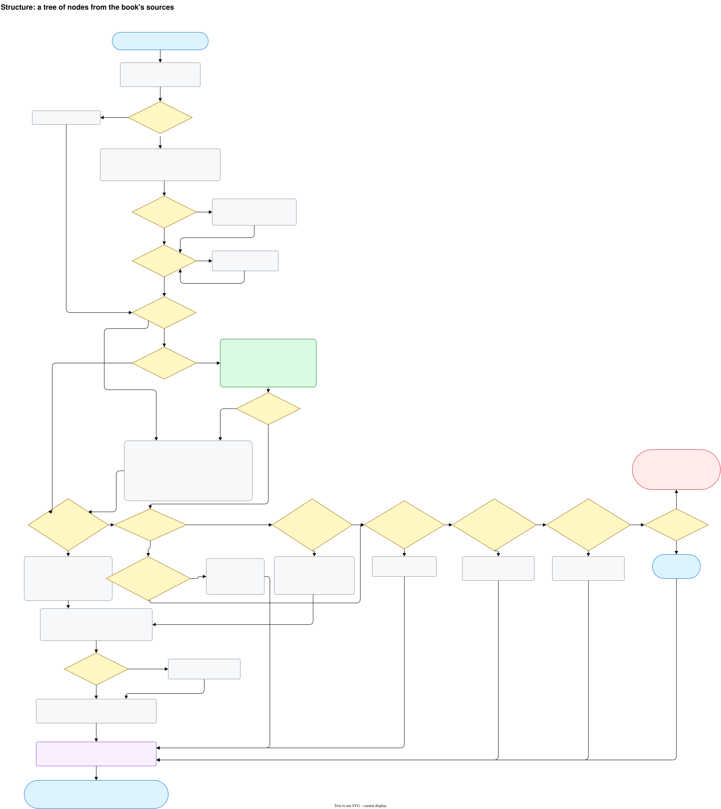
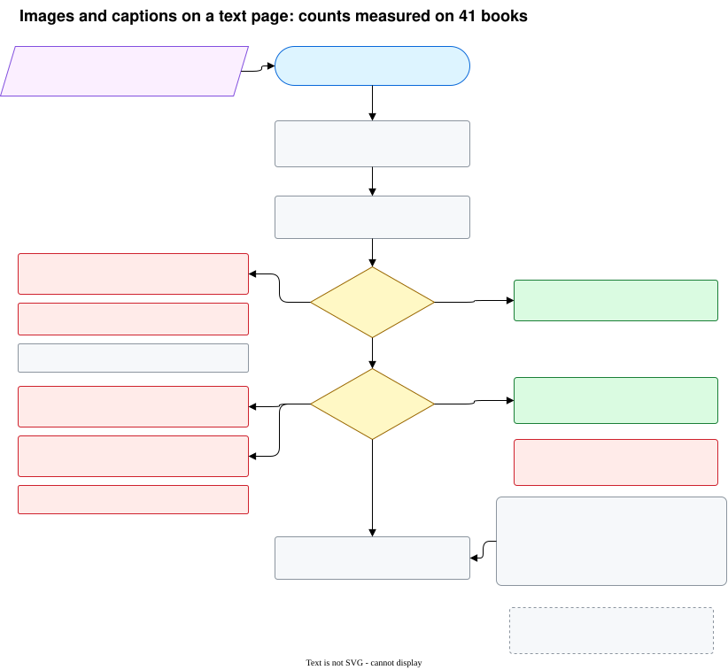
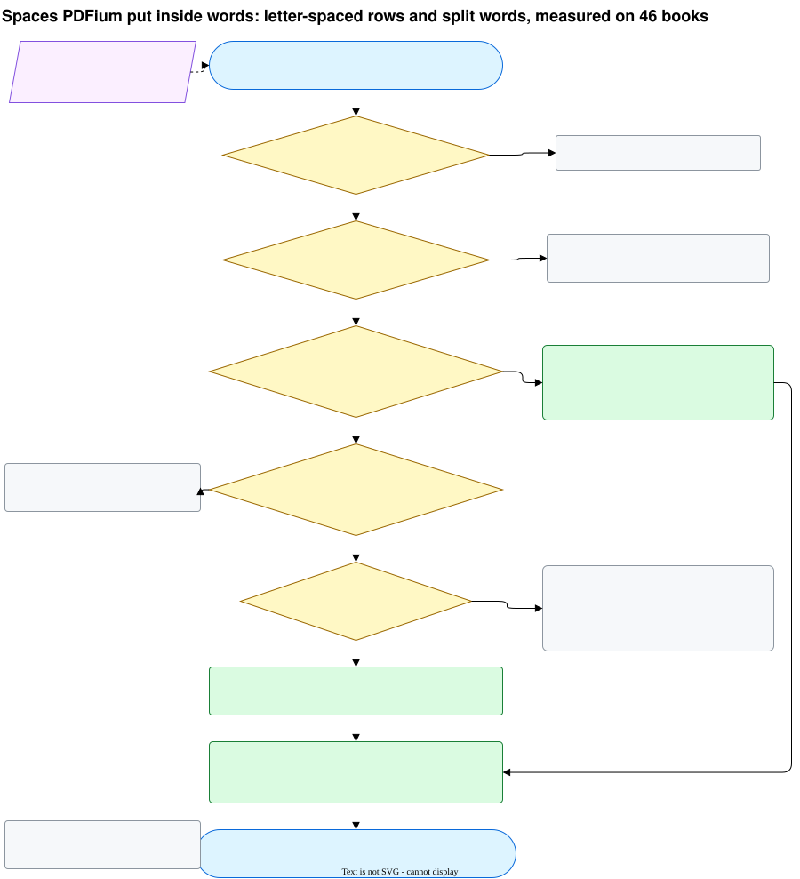

# ocr-lab

[](https://github.com/rikitikitav1/ocr-lab/actions/workflows/ci.yml)
[](../LICENSE)
[](../pyproject.toml)
[](https://github.com/astral-sh/ruff)

> English: [../README.md](../README.md) · Журнал экспериментов: [experiments.md](experiments.md) · Что значат числа отчёта: [measurement.md](measurement.md) · Состояние шагов: [status.md](status.md)

ocr-lab превращает электронную книгу в структурированный документ, разделы которого совпадают с
разделами книги. На вход подаётся PDF (с текстовым слоем или скан, один файл или несколько), выбирается
формат, а на выходе получается Markdown с разделами книги на правильных уровнях заголовков, папка
картинок, на которые ссылается текст, и отчёт о том, насколько хорош результат. Первый формат вывода
Markdown; DoclingDocument для RAG появится позже, как и входные EPUB и HTML.

Зачем: бандлы становятся источниками поисковой системы ([rag-lab](https://github.com/rikitikitav1/rag-lab)), а
такая система отвечает не лучше своих источников. Текст, потерянный по дороге, не найдёт ни один вопрос. Раздел,
разрезанный не там, даёт куски, в которых смешаны две темы, а заголовок на правильном уровне это контекст, без
которого кусок текста не находится. Таблица или листинг, прочитанные как проза, теряют смысл, а колонтитулы и
страницы, взятые дважды, добавляют шум, который встаёт в выдаче рядом с настоящим текстом. Поэтому стенд сохраняет
структуру самой книги, читает каждую страницу двумя движками и текстовым слоем и вместо обещания, что всё хорошо,
показывает по каждому куску прогона, что потеряно и что добавлено.

Книги все разные, поэтому одной настройки на все не бывает. У каждой книги свой профиль ручек (откуда
брать структуру, как узнать заголовок раздела, блок кода, врезку, таблицу или колонтитул), стенд
подбирает значения замерами, и каждый этап оставляет после себя файл, так что прогон можно проследить
по шагам и продолжить после падения.

Правила, которых держится проект, записаны в [конституции](../.specify/memory/constitution.md); фича,
которая сейчас строится, описана в [specs/001-pdf-book-to-markdown](../specs/001-pdf-book-to-markdown/spec.md).

## Статус

Где стоит каждый шаг: [status.md](status.md).

## Что сейчас происходит с PDF

<details open>
<summary>Схема: от поданного PDF до записи в каталоге с метаданными</summary>


</details>

<details>
<summary>Схема: сбор метаданных книги, все ветки и что даёт каждый источник</summary>


</details>

<details>
<summary>Схема: поиск структуры, все ветки</summary>



</details>

<details>
<summary>Схема: структура из заголовков, последняя попытка, каждый порог и откуда он взят</summary>


</details>

1. **Подача.** `POST /v1/books` (или MCP-инструмент `add_book`) принимает пути на полке или в
   `data/inbox`, по порядку; `POST /v1/books/upload` принимает сами байты. Каждый файл должен быть целым
   `.pdf`: другое расширение, файл, который не PDF, или недокачанный файл получают отказ до того, как что-то сохранено. Книга определяется хешами
   своих файлов по порядку, поэтому те же файлы, поданные повторно, возвращают ту же книгу, и в очередь
   ничего не встаёт. Два издания это две книги. Книга, разбитая на несколько файлов, подаётся одной
   заявкой; тома серии это отдельные книги, связанные полями `series` и `volume`. Файл хранится один раз
   по содержимому (`data/files/`); папка книги ссылается на каждый её файл по порядку и имени в
   `data/books/<id>/source/`.
2. **Приёмка** (CPU-полоса). По каждой странице: есть ли текстовый слой. По каждому файлу: закладки.
   На первых 30 страницах, а если там ничего нет, на последних 30: страницы оглавления, по отточиям или по
   нумерованным строкам, чьи номера страниц растут через всю книгу. Результат сохраняется как `probe.json`
   и используется повторно, пока файлы не менялись.
3. **Метаданные** (CPU-полоса; распознавание или вызов модели, которых ещё нет в кэше, переводят задачу
   на GPU-полосу). Титульные страницы и страницы с копирайтом (по умолчанию первые 20 и последние 20;
   это ручка книги, см. ниже) читаются из текстового слоя или распознаются MinerU, если слоя нет или он
   испорчен. Сначала работают скрипты, без списков слов какого-либо языка: info и XMP каждого файла PDF
   (значение, похожее на имя файла или штамп, игнорируется; Producer и Creator сохраняются как `made_with`), ISBN по правилам агентства ISBN (из двух напечатанных перевод оставляет тот, что зарегистрирован в группе его языка, по диапазонам агентства и CLDR), год, серия из
   библиографической карточки, язык основного текста. Затем локальная модель (ollama) читает титульные
   страницы, находит название, авторов, издание, том и издательство и называет тему книги. Всё берётся
   из самой книги: никаких каталогов и поиска в сети на этом этапе.
4. **Разрешение.** Каждое поле берёт значение источника с наивысшим рангом. Расходящиеся источники
   отмечаются как конфликт и снижают уверенность. Поле, которое никто не нашёл, остаётся пустым и
   перечисляет все источники, которые пробовали; ничего не угадывается. Результат это новая версия
   метаданных; старые версии сохраняются.
5. **Что получаешь.** `GET /v1/books/{id}` показывает файлы, страницы, текстовый слой, закладки,
   печатное оглавление и метаданные; `GET /v1/books/{id}/metadata` показывает каждое поле со значением,
   источником, уверенностью и попытками. Поле можно задать руками (`PATCH /v1/books/{id}/metadata/{name}`,
   новая версия); само содержимое книги руками никогда не правится. `POST /v1/books/{id}/recollect`
   собирает заново; с `"run": true` запускает прогон, как только собрана структура, поэтому в `what`
   должен быть `structure`.
6. **Раскладка страниц** (CPU-полоса). После метаданных (или сразу после приёмки, если в `then` нет `metadata`)
   из текстового слоя книги узнаются её колонтитулы, номера страниц, строки сносок и доля букв, набранных
   моноширинным шрифтом (`GET /v1/books/{id}/layout`). Их читает сборка, по ним выбирается пресет прогона;
   прогон работает на той версии раскладки страниц, с которой начал. После неё в очередь встаёт задание
   структуры, а после структуры раскладка заголовков.
7. **Структура** (CPU-полоса; GPU только для распознавания растра). Оглавление, напечатанное в книге,
   ищется в текстовом слое, а на растре, когда ни текст, ни закладки, ни файлы глав его не дают;
   оглавление на нескольких страницах читается как одно, и его печатные номера страниц переводятся в
   страницы PDF. После сверки с закладками, файлами глав и нумерацией получается версия структуры, дерево узлов с
   уровнем, родителем, первой и последней страницей каждого узла (`GET /v1/books/{id}/structure`). Когда больше ничто не держит
   структуру, узлы текстовой книги дают строки, которые её текстовый слой выделяет размером или насыщенностью,
   сгруппированные по виду так же, как заголовки ниже (нумерация голосует за них); они отвергаются как сломанный
   текстовый слой, когда половина из них содержит буквы, которыми языки книги не пишут. Если их нет, структурой
   становятся главы, открывающиеся меткой из книжной ручки `structure.chapter_label`, когда она задана (и для скана;
   заголовки текстового слоя тогда не читаются), затем помеченные главы в тексте ("Chapter N", три или больше,
   номера растут), затем слово, которое текст повторяет перед номерами своих глав ("Глава осма").
   Если нет и их, все страницы читаются картинками, и узлы дают заголовки, сгруппированные по виду
   (книжная ручка `structure.from_headings`, по умолчанию включена); если и они не дали узлов или дали больше
   одного узла на две страницы, книга до 100 страниц становится одним узлом, а более длинная падает с
   "structure not recognised". `POST /v1/eval/structure` оценивает стадию отдельно: с `bookmarks_off` по закладкам,
   с `contents_off` (выключены и закладки, и печатное содержание) по структуре, которую они дали, так что книги с
   содержанием играют роль книг без него.
8. **Прогон** (`POST /v1/books/{id}/runs`, MCP `start_run`). Каждый кусок на GPU-полосе читают Docling
   и MinerU, затем она собирается постранично на CPU-полосе; страницы без пригодного слоя оба движка
   читают в режиме OCR. Прогон собирается с профилем: значением каждой ручки прогона и тем, откуда оно
   взялось (из пресета, который выбирает раскладка страниц книги, см. ниже, если профиль не задан). Бандл в `bundles/<book>/<run>/`
   содержит Markdown книги, картинки, `profile.yaml` и `report.json`/`report.md` с числами по кускам и по
   книге: сколько текста потеряно и добавлено относительно слоя (без собственных колонтитулов и номеров
   страниц книги), сколько слов слоя движок отложил сверх них, сколько слов пришло со страниц, которых
   проверка по слою не видит, сколько найдено разделов, сколько абзацев встречено в куске дважды, какая доля серий слов слоя стоит не
   по порядку, сколько распознанных и картиночных страниц и насколько согласны движки. Если два куска
   встречаются на одной странице, она режется по их заголовкам и оценивается по обеим. Диапазон, который
   MinerU не вмещает в память GPU, читается заново половинами. Каждый узел структуры открывается
   комментарием `<!-- node ... -->` там, где нашёлся его заголовок, `structure.json` перечисляет их все, и каждый
   блок знает свой узел (`blocks_without_node` и `blocks_in_two` в отчёте равны 0, когда текст разрезан чисто).
   Прогон читает по дереву: узлы одного уровня (автоматический, пока всегда 0; ручка книги
   `structure.reading_level` его перебивает), узел длиннее 100 страниц его собственными страницами и детьми,
   никогда не по страницам, и каждый кусок дочитывает первую страницу следующего, чтобы отрезать свой хвост по следующему заголовку; уровень
   фиксируется в прогоне при старте. Узел можно перепрогнать с переопределёнными ручками
   (`POST /v1/runs/{id}/nodes/{ord}/rerun`, перепрогоняется кусок, где он лежит), это создаёт производный
   профиль. Результат книги это её лучший завершённый прогон на текущей структуре.

<details>
<summary>Схема: прогон книги, от структуры до бандла</summary>


</details>

<details>
<summary>Схема: распознавание растровой страницы, от двух движков до согласия</summary>


Оба движка читают каждый распознаваемый диапазон; текст берётся от MinerU, слова Docling только меряют согласие. Пунктирные блоки запланированы, но не сделаны.

</details>

<details>
<summary>Схема: код на текстовой странице, от блоков движков до огороженного кода</summary>


</details>

<details>
<summary>Схема: картинки и подписи на текстовой странице, замер на 41 книге</summary>



</details>

<details>
<summary>Схема: пробелы, которые PDFium вставляет внутрь слов, замер на 46 книгах</summary>



</details>

Ручки уровня книги можно задать при подаче (`"knobs": {...}` в `POST /v1/books`) или поменять позже
(`PATCH /v1/books/{id}/knobs`): `metadata.title_pages.head` и `.tail` (по умолчанию 20 и 20, в
`config/metadata.yaml`), `structure.contents_pages`, страницы печатного оглавления в виде `[[first, last], ...]`,
если известно, где они, `structure.skip_root_bookmark`, когда первая закладка это сама книга,
`structure.ignore_bookmarks`, когда закладки не оглавление (по одной на страницу, имена файлов картинок),
`structure.chapter_label`, слово, с которого начинаются главы: строка из него и ещё одного слова вверху
страницы открывает узел ("درس" для уроков "درس اول", "درس دوم" персидской хрестоматии; скан тогда
распознаётся целиком), и `structure.from_headings` (по умолчанию включена), последняя попытка перед провалом книги без оглавления:
все страницы читаются картинками, и узлы берутся из заголовков, сгруппированных по виду
(`config/structure.yaml`, `scan_layer.headings`); false даёт книге упасть сразу. Изменение вступает в силу при следующем сборе. В заявке можно также указать
`"then": ["structure"]`, чтобы пропустить метаданные, и `"order": "by_number"`, чтобы упорядочить файлы глав
по номеру, который каждый из них печатает.

Ручки прогона со своими вариантами, подсказками и значениями по умолчанию перечислены в `GET /v1/knobs`
(`config/knobs.yaml`, значения по умолчанию в `config/assembly.yaml`), пресеты в `GET /v1/presets`
(`config/presets/`). Прогон начинается с пресета `technical` (проходы кода, читающие глифы слоя), когда раскладка
страниц находит моноширинное начертание с 2% букв на 5 страницах и больше, иначе с `default`; книжная ручка `run.preset` называет пресет
сама. Профиль читается через `GET /v1/profiles/{id}`; `POST /v1/profiles/{id}/derive` с
`{"set": {...}, "pieces": {"<ord>": {...}}}` делает новый профиль, с которым можно запустить прогон
(`"profile_id"` в `POST /v1/books/{id}/runs`).

Этап, который продолжает падать, останавливается, исчерпав бюджет попыток (от 3 до 5, у каждого этапа
свой, в `config/budgets.yaml`), и ждёт; после разбора `POST /v1/jobs/retry` даёт ему свежий бюджет. Повторённое задание прогона
заново открывает свой кусок и сам прогон, так что его успех доводит прогон до конца, как `resume_run`; прогон, у
которого окончательно упал старт или итоговая сборка, называет ошибку в `GET /v1/runs/{id}` (`errors`) и ждёт в
состоянии «требует внимания».

## Машина, на которой это сделано

Всё здесь собрано и измерено на одном ноутбуке. Движкам и моделям нужна видеокарта NVIDIA; без неё
ничего не пробовали.

| часть | что это | кто ей пользуется |
|---|---|---|
| GPU | NVIDIA GeForce RTX 4070 Laptop, 8 ГБ | Docling и MinerU (разметка, OCR), ollama с qwen2.5 7B и gemma2 9B; по одному, очередь заданий передаёт карту от одного к другому; vLLM MinerU получает 60% карты (`MINERU_VIRTUAL_VRAM_SIZE` в docker-compose.yml) |
| CPU | Intel Core i9-14900HX, 32 потока | текстовый слой, источники структуры, скрипты метаданных, проходы сборки, отчёт; CPU-полоса одного воркера и сколько угодно воркеров только для CPU |
| RAM | 64 ГБ | |
| диск | образ MinerU 28 ГБ, образ Docling 11 ГБ, ollama 5 ГБ плюс модели; данные стенда на 125 книг с их прогонами 13 ГБ | |

Без дискретной видеокарты должны работать каталог, структура по текстовому слою (закладки, печатное
оглавление, нумерация), скрипты метаданных и отчёт, но прочитать книгу движками нельзя, а значит, и
прогона не будет. Для масштаба: учебник на фарси, 169 страниц скана, которые оба движка читали в режиме OCR,
занял около 29 минут работы заданий.

Время на страницу по фазам, книги со слоем и сканы отдельно: [timing.md](timing.md).

## Какие языки пробовали

На полке 125 книг; таблица считает 117, что были на ней к сырому прогону, словари и разговорники, добавленные
после (120 до 128), перечислены в [books.md](books.md). Книга на двух языках считается в обоих. Полные прогоны это сырой прогон 43 книг и книги, прогнанные после него, всего 47
([эксперимент](experiments/2026-10-11_raw-run.md)).

| язык | книг | из них сканов | что проверяли |
|---|---|---|---|
| английский | 93 | 2 | структура (без закладок, HiPS), метаданные, элементы, полные прогоны 25 книг (одна из них англо-китайский скан) |
| русский | 14 | 4 | структура, метаданные, элементы (русские эталонные разделы rag-lab), полные прогоны 13 книг, из них 4 скана |
| болгарский | 4 | 0 | структура, полные прогоны всех 4 |
| румынский | 2 | 0 (старый текстовый слой) | структура, полные прогоны обеих (монография о селе 1905 года, книга о селе 1998 года) |
| фарси | 2 | 1 | структура с ручками книги, полный прогон (учебник чтения на фарси) |
| украинский | 1 | 0 | структура, полный прогон |
| французский | 1 | 0 | структура, полный прогон |
| китайский | 2 | 2 | структура, полный прогон одной (вторая, курс китайского, определитель языка записал как русский) |

Все книги полки с языком, видом и замерами, в которых они участвуют: [books.md](books.md).
Чего стенд пока не умеет: [limitations.md](limitations.md).

## Запуск стенда

Стенд использует то, что rag-lab уже скачал: образы конвертеров с их моделями, модели ollama, кэш
Hugging Face и книги с полки rag-lab. Ничего не скачивается. Оба стенда делят одну видеокарту, поэтому
конвертеры rag-lab должны быть остановлены, пока работают конвертеры ocr-lab.

```bash
cp .env.example .env                      # optional key: a cloud model
docker compose up -d                      # postgres, migrations, api, worker, ollama, converters
docker compose --profile cpu-workers up -d --scale worker-cpu=2   # optional: workers for the CPU lane only
curl -s localhost:8100/v1/stand | jq      # health, engine builds, who holds the GPU, every worker and its code
```

Задания идут по двум полосам. GPU-полосу держит один воркер за раз (блокировка в Postgres), так что движки и модели
никогда не делят карту; CPU-полосу (приёмка, метаданные, раскладка страниц, структура, сборка, отчёты, оценки структуры) берёт любой воркер; оценка элементов читает на GPU-полосе. `worker` берёт
обе полосы (`WORKER_LANES`, по умолчанию `cpu,gpu`), `worker-cpu` только CPU. Умерший или убитый воркер оставляет свои
задания другим: живой воркер держит блокировку своего хоста, а задания хоста, чья блокировка свободна, возвращаются в
очередь, так что прогон едет дальше без `resume`. Идущее задание, которое не называет ни один воркер, тоже
возвращается, чужие задания воркер забирает, только продержав свою блокировку два такта, а запоздалый итог воркера,
у которого задание уже забрали, не учитывается. Воркер, молчащий сутки, пропадает из списка стенда.

Подать книгу, дождаться её и забрать результат: `then` с `"run"` запускает прогон, как только готова
структура (и требует `"structure"` в том же `then`), а ожидание задания приёмки ждёт всю цепочку (без `"run"` всё останавливается на структуре, чтобы
сначала посмотреть на неё):

```bash
curl -s -F files=@book.pdf -F 'then=["metadata","structure","run"]' localhost:8100/v1/books/upload | jq '{id, job_id}'
curl -s 'localhost:8100/v1/jobs/<job_id>/wait?timeout=36000' | jq '{finished, stopped_runs}'
curl -s localhost:8100/v1/books/<id>/bundle -o book.tar       # результат книги: Markdown, картинки, отчёты
```

Книга с полки подаётся путём: `POST /v1/books` с `{"shelf_paths": [...], "then": [...]}`.

Верстачные двери прогоны не меняют: `read_range` читает диапазон страниц книги одним движком и сохраняет чтение (с
`force_raster_only` MinerU читает каждую страницу как картинку, как скан), `reassemble` заново собирает куски
прогона из сохранённых чтений с заданными ручками и отдаёт числа каждого куска до и после, `artifact` читает любой
сохранённый артефакт по id, а `reload_worker` велит каждому живому воркеру взять новый код, как только кончатся задачи в работе,
так что идущий прогон тогда смешает версии кода.

## Для агентов

Стенд рассчитан на то, что им управляет агент, а не только человек. Каждая операция это и REST-роут, и
MCP-инструмент с одной реализацией, и у каждого инструмента в описании сказано, что он делает, что возвращает и
что ставит в очередь. Ошибка называет свой вид (`refused`, `missing`, `busy`, `retry_later`, `fault`; `busy` это ещё идущий прогон, которого надо дождаться или отменить), так что агент
отличает неверный ввод от случая, когда надо подождать. Для ожидания есть двери (`wait_job`, `wait_runs`), которые
блокируют до конца работы вместо опроса, списки по умолчанию краткие, а идущий прогон показывает прочтения по
движкам.

MCP-клиент подключается к поднятому стенду по streamable HTTP и сам получает список всех инструментов с
описаниями. Для Claude Code так:

```bash
claude mcp add --transport http ocr-lab http://localhost:8100/mcp
```

Обычная сессия агента: `add_book`, потом `book`, пока книга не станет `ready` (или `structure`, чтобы увидеть узлы),
`start_run`, `wait_runs`, `report` за числами и `book_bundle` за тем, где лежит результат; бандл одним tar это
`GET /v1/books/{id}/bundle`.

## Разработка

```bash
uv sync
scripts/check.sh          # ruff, then pytest (unit and door tests need postgres on localhost:5433)
uv run pytest -m stand    # checks against the running stand
scripts/dump_schema.sh    # after a new migration
```

Схемы хранятся в файлах `.drawio.svg`: открываешь в draw.io (или в его расширении для VS Code),
правишь, сохраняешь; картинка и её исходник остаются в одном файле.

Код, документация и замеры пишутся вместе с Claude (Opus) в Claude Code.

## Лицензия

[MIT](../LICENSE)
